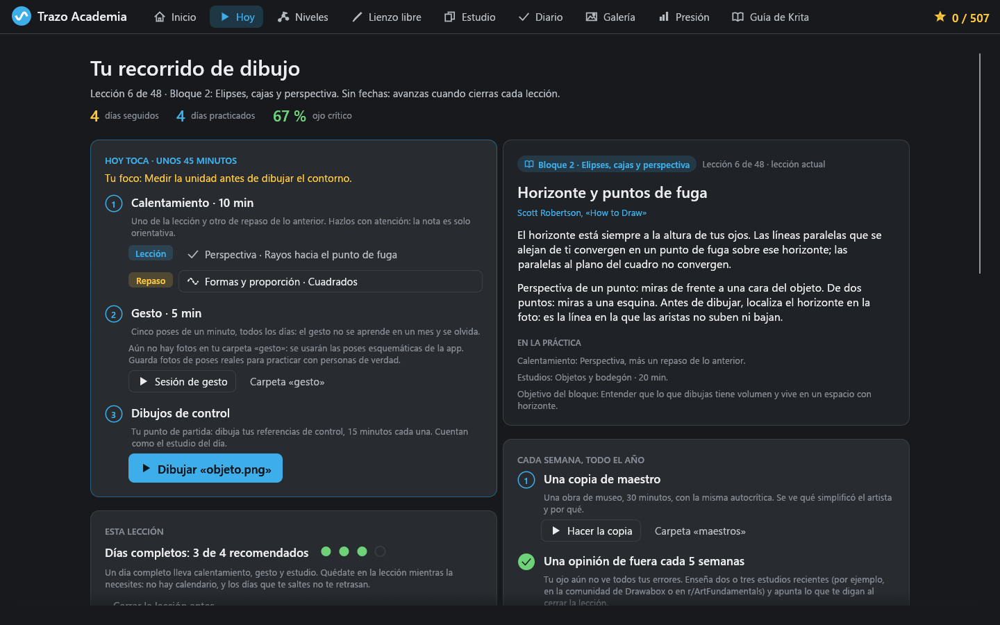
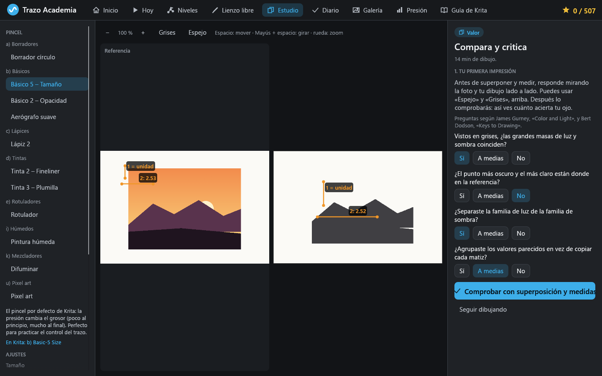
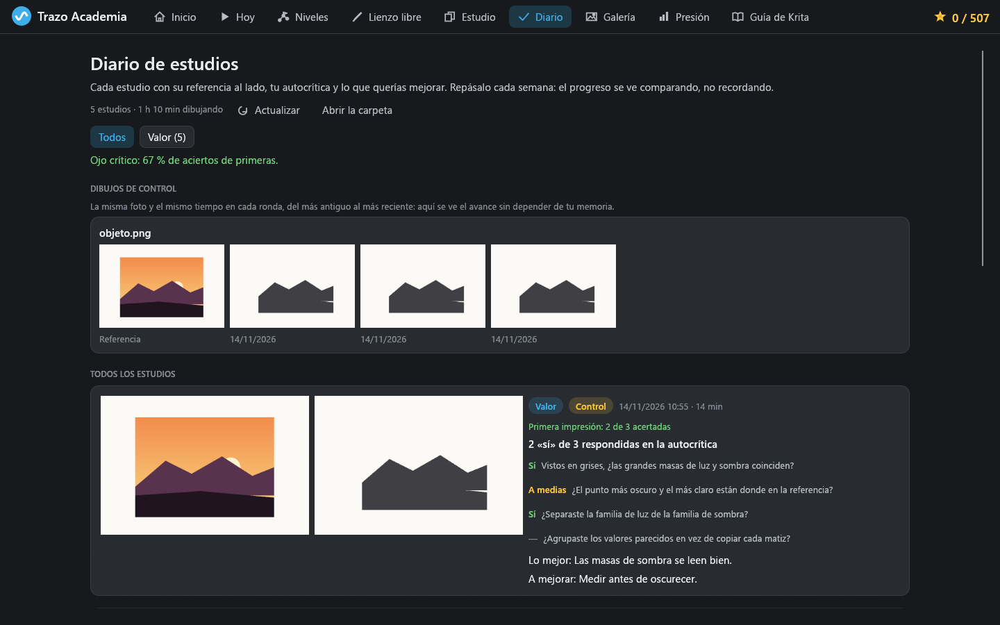

# Trazo Academia

Aplicación de escritorio para aprender a dibujar en digital, con los pinceles y el suavizado de trazo de
[Krita](https://krita.org). Combina ejercicios de fundamentos con nota automática, estudios del natural con
referencia y autocrítica guiada, y un recorrido de 48 lecciones basadas en libros de dibujo conocidos.

*A desktop app (Rust + egui) to learn digital drawing with Krita's brushes and stroke smoothing: graded
fundamentals drills, reference studies with comparison tools and guided self-critique, and a 48-lesson path
grounded in well-known drawing books. The interface is in Spanish.*

> Proyecto personal y de portafolio. **No está afiliado a la Krita Foundation ni respaldado por ella.**
> «Krita» es una marca de la Krita Foundation y aquí solo se usa para decir qué programa enseña la app.



## Qué tiene

- **Hoy:** la práctica del día (unos 45 minutos). Calentamiento con un ejercicio de la lección y otro de
  repaso, cinco gestos de un minuto, y un estudio con referencia o los dibujos de control. Racha, revisión
  al cerrar cada lección y un mapa de los 12 bloques.
- **Estudio con referencia:** la foto al lado de tu lienzo (zoom, girar, voltear, ocultar). Primero
  respondes la autocrítica por tu cuenta y después compruebas superponiendo la referencia, alternando,
  con espejo, grises, rejilla y medidas en unidades, como enseña Betty Edwards. La app guarda cuántas veces
  acertó tu primera impresión: tu **ojo crítico**.
- **Diario:** cada estudio con su referencia, tus respuestas y notas. Los **dibujos de control** (las mismas
  fotos cada cuatro semanas) se ven en fila para comprobar el avance.
- **169 ejercicios con nota** en 17 módulos: líneas, elipses, peso de línea, proporción, perspectiva,
  volumen, sombreado, figura, cabeza, manos, entintado, observación, valor, luz, bordes y color.
- **Lienzo libre** con capas, referencia, rejilla, vista girada o en espejo, galería y sesiones de gesto.
- **Presión del lápiz** con curva calibrable, y los modos de suavizado de Krita (básico, ponderado,
  estabilizador y píxel).



## Por qué está hecho así

La mayoría de los errores al dibujar del natural vienen de percibir mal, no de la mano. Además, los
principiantes se autoevalúan mal, y la práctica repartida y mezclada retiene mejor que la práctica en
bloques. Por eso el centro de la app son las herramientas que no se dejan engañar (superponer y medir), la
primera impresión que luego se comprueba, la opinión de fuera periódica y un recorrido sin fechas que
repasa siempre lo aprendido. Las fuentes y los detalles están en [app/MECHANICS.md](app/MECHANICS.md)
(secciones 5 y 6).



## Compilar y ejecutar

Necesitas [Rust](https://rustup.rs) (edición 2024).

```bash
cd app
cargo run --release
```

- Solo se ha probado en **Windows**. En Linux y macOS debería compilar (eframe con glow), pero no está
  comprobado.
- En Windows con el toolchain **GNU**, algunas dependencias necesitan `dlltool`: sigue las instrucciones de
  [app/.cargo/config.toml.example](app/.cargo/config.toml.example). Con el toolchain MSVC no hace falta.
- `cargo test` pasa los tests de contenido, calificación, lienzo, programa y diario.

Los datos se guardan en `%APPDATA%\TrazoAcademia\progreso.json` (progreso) y en
`Imágenes\TrazoAcademia\` (dibujos, diario de estudios y biblioteca de referencias, con una carpeta por
tema y otra, `control`, para las fotos de los dibujos de control).

El contenido (módulos, ejercicios y lecciones) está en JSON en [app/content](app/content); el formato se
explica en [app/content/README.md](app/content/README.md).

## Créditos

- **Krita** ([krita.org](https://krita.org), código en
  [invent.kde.org/graphics/krita](https://invent.kde.org/graphics/krita)), de la Krita Foundation y sus
  colaboradores, con licencia GNU GPL. Los modos de suavizado, la curva de presión, los valores por defecto
  y los parámetros de los pinceles (curvas de los sensores, dureza y espaciado de los preajustes por
  defecto de Krita) se han reimplementado a partir de Krita. [app/MECHANICS.md](app/MECHANICS.md) indica de
  dónde sale cada valor. Los nombres de los pinceles se muestran para que se puedan encontrar en Krita.
- Las lecciones y las preguntas de autocrítica son textos propios que resumen ideas de los libros y métodos
  que citan (Drawabox, Betty Edwards, Scott Robertson, Bert Dodson, James Gurney, Kimon Nicolaïdes, Walt
  Stanchfield, Andrew Loomis, Michael Hampton, George Bridgman, Burne Hogarth, Ken Hultgren, Richard Schmid
  y John Asaro). No incluyen texto ni imágenes de esos libros.
- Las imágenes de referencia no forman parte del proyecto: cada persona usa sus propias fotos.

## Licencia

[GNU General Public License v3.0 o posterior](LICENSE) (GPL-3.0-or-later), la misma familia de licencias
que Krita, de la que esta app deriva parte de su comportamiento.

Copyright (C) 2026 LeZuni.
